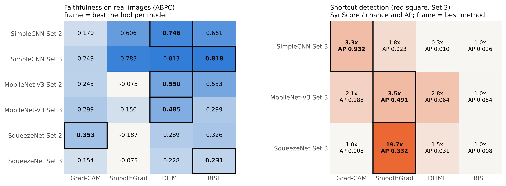

# XAI Benchmarking with Synthetic Ground Truth for Hand-Gesture CNNs

[](https://github.com/suzan-elmasry/xai-gesture-benchmark/actions/workflows/ci.yml)


Code and results of the Bachelor thesis

> **Explainable AI (XAI) benchmarking and synthetic ground-truth evaluations for computer vision models**
> Suzan Elmasry – Bachelor thesis, Mechatronik, Hochschule Ruhr West, 2026

Three CNN architectures were trained to recognise four hand gestures (Down, Left, Right, Up) for controlling a robot arm. Each model was trained twice: on **Set 2** (hand on a Gaussian-noise background) and on **Set 3** (Set 2 + a red square on every *Up* image, a deliberately inserted shortcut). The models are then explained with several XAI methods and the explanations are evaluated

1. on a **real-world validation set** (80 webcam images) with the perturbation metrics **MoRF, LeRF and ABPC** compared with a random removal order, following the M4 benchmark, and
2. on the **Set 3 *Up* images** with the **SynScore** (share of the relevance inside the red square, plus M4 SynScore AUC-ROC and AP), since the shortcut location is known.

| Architecture | Grad-CAM layer |
|---|---|
| SimpleCNN (3 conv blocks) | `conv3` (56 × 56) |
| MobileNet-V3-Small | `features[-1]` (7 × 7) |
| SqueezeNet 1.1 | last Fire module `features[-1]` (13 × 13) |

## Explanation methods

| Method | Type | Settings |
|---|---|---|
| Grad-CAM | gradient, layer-level | Captum `LayerGradCam`, positive part only, bilinear upsampling to 224 × 224 |
| SmoothGrad | gradient, pixel-level | Captum `NoiseTunnel(Saliency)`, 50 samples, σ = 0.15 · (max − min), mean over colour channels |
| DLIME | perturbation, superpixel-level | 50 SLIC superpixels, 1,000 Sobol samples, Ward clustering (10) + 5-NN, Ridge (α = 1); deterministic |
| RISE | perturbation, random masks | 4,000 masks, 7 × 7 grid, p = 0.5, bilinear upsampling + random shift, seed 7; the same masks for every image |

## Repository structure

```
├── src/xai_gesture_benchmark/
│   ├── config.py        # fixed settings: seed, classes, normalisation, split
│   ├── models.py        # SimpleCNN, MobileNet-V3-Small, SqueezeNet 1.1 (4-class heads)
│   ├── explainers.py    # Grad-CAM, SmoothGrad, DLIME, RISE
│   ├── metrics.py       # MoRF / LeRF / ABPC curves and SynScore
│   └── evaluate.py      # command-line tool `xai-eval`
├── tests/               # unit and end-to-end tests (CPU, < 1 min)
├── run_in_colab.ipynb   # all 24 evaluations in Google Colab
├── results/
│   ├── summary.csv      # all numbers reported in the thesis
│   └── figures/         # summary figures of Chapters 4 and 5
├── EXPERIMENT.md        # hypothesis, method, data provenance, result
├── TEST_STRATEGY.md     # what is tested and why
├── data/  models/       # dataset and weight descriptions (not included)
└── training/            # data generation and training code
```

## Usage

```bash
pip install -e .

xai-eval --model squeezenet --set 3 --method dlime \
    --weights models/squeezenet_set3.pth \
    --val-dir data/validation_set_roi \
    --set3-dir data/set3_xai_trap
```

| Argument | Values |
|---|---|
| `--model` | `simplecnn`, `mobilenet`, `squeezenet` |
| `--set` | `2`, `3` (SynScore is computed only for `3`) |
| `--method` | `gradcam`, `smoothgrad`, `dlime`, `rise` |
| `--out` | output folder (default `outputs/`) |

Each run creates `outputs/<method>_<model>_set<set>/` with `maps.png`, `perturbation_curves.png`, `confusion_matrix.png`, `faithfulness_per_image.csv`, `results.json` and, for Set 3, `synscore.png` and `synscore_per_image.csv`. A GPU is recommended: DLIME needs about 1,000 and RISE 4,000 forward passes per image, and the RISE masks take about 0.8 GB of memory.

### Evaluation details

- Removed pixels are set to 0 in the normalised input, which equals the dataset mean.
- 11 steps (0 %, 10 %, …, 100 %). MoRF = mean drop of the confidence of the predicted class when the most relevant pixels are removed first; LeRF = the same with the least relevant pixels first; ABPC = mean area between the LeRF and MoRF curves.
- The random baseline removes pixels in a random order (seed 7). Ties in the relevance (e.g. inside a superpixel) are broken by tiny random noise.
- SynScore uses only positive relevance. Chance level = area of the square ≈ 0.58 % of the image.

## Main results

| Model | ABPC Grad-CAM | ABPC SmoothGrad | ABPC DLIME | ABPC RISE | SynScore AUC-ROC (GC / SG / DLIME / RISE) |
|---|---|---|---|---|---|
| SimpleCNN Set 2 | 0.170 | 0.606 | **0.746** | 0.661 | – |
| SimpleCNN Set 3 | 0.249 | 0.783 | 0.813 | **0.818** | **1.000** / 0.806 / 0.332 / 0.395 |
| MobileNet-V3 Set 2 | 0.245 | −0.075 | **0.550** | 0.533 | – |
| MobileNet-V3 Set 3 | 0.299 | 0.150 | **0.485** | 0.299 | 0.938 / **0.979** / 0.808 / 0.844 |
| SqueezeNet Set 2 | **0.353** | −0.187 | 0.289 | 0.326 | – |
| SqueezeNet Set 3 | 0.154 | −0.075 | 0.228 | **0.231** | 0.602 / **0.958** / 0.638 / 0.566 |

All values are in [`results/summary.csv`](results/summary.csv). No single method was best:

- **Faithfulness on real images:** the perturbation-based methods (DLIME, RISE) reach the highest ABPC for five of six models. They are favoured by MoRF/ABPC, because they remove image regions in the same way as the metric (as also reported by M4 for LIME).
- **Shortcut detection:** only the gradient-based methods clearly find the red square (Grad-CAM for SimpleCNN, SmoothGrad for MobileNet-V3 and SqueezeNet). DLIME and RISE stay at chance level, because their superpixels / 7 × 7 grid cells are larger than the square, and RISE gives every pixel a large base value.



## Development

```bash
pip install -e ".[dev]"
pre-commit install && pre-commit install --hook-type commit-msg

ruff check . && ruff format --check .   # lint + formatting
mypy src                                 # type check
pytest                                   # all tests
pytest -m "not slow"                     # fast tests only
```

Commit messages follow [Conventional Commits](https://www.conventionalcommits.org/) (`feat:`, `fix:`, `docs:`, `test:` …). The same checks run in GitHub Actions on every push.

## References

- R. R. Selvaraju et al., *Grad-CAM: Visual explanations from deep networks via gradient-based localization*, ICCV 2017.
- D. Smilkov et al., *SmoothGrad: removing noise by adding noise*, arXiv:1706.03825, 2017.
- V. Petsiuk, A. Das and K. Saenko, *RISE: Randomized input sampling for explanation of black-box models*, BMVC 2018.
- M. R. Zafar and N. M. Khan, *DLIME: A deterministic local interpretable model-agnostic explanations approach for computer-aided diagnosis systems*, arXiv:1906.10263, 2019.
- X. Li et al., *M4: A unified XAI benchmark for faithfulness evaluation of feature attribution methods across metrics, modalities and models*, NeurIPS 2023 Datasets and Benchmarks.

## Use of AI tools

Parts of the code in this repository were written with the help of an AI assistant (Claude, Anthropic) and were reviewed, run and checked by the author. See Appendix A of the thesis.

## Citation

If you use this code, please cite it via the **Cite this repository** button (see [`CITATION.cff`](CITATION.cff)).

## License

MIT – see [LICENSE](LICENSE).
